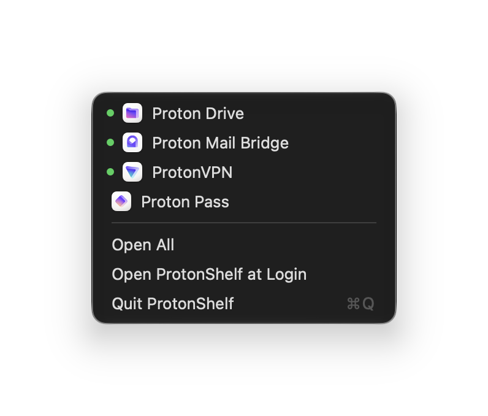

# ProtonShelf

A tiny macOS menu bar app: one atom icon that drops down a list of your installed Proton apps (VPN, Pass, Drive, Mail Bridge…).

- Click an app to open it or bring its window forward.
- Hold ⌥ while the menu is open to quit an app instead.
- A green dot marks apps that are running.
- "Open All" launches every Proton app that isn't running.

Any app in `/Applications` or `~/Applications` whose name starts with "Proton" is listed automatically.

Pair it with a menu bar hider (Hidden Bar, Ice, Bartender) to tuck the Proton apps' own icons away.

<p align="center"></p>

## Install

1. Download **[ProtonShelf.zip](https://github.com/capheproject/ProtonShelf/releases/latest/download/ProtonShelf.zip)** from the [latest release](https://github.com/capheproject/ProtonShelf/releases/latest), unzip it, and drag **ProtonShelf.app** into your Applications folder.
2. Open it. The app is free and open source but not notarized by Apple, so the first time macOS stops it with a message like *“Apple could not verify ProtonShelf is free of malware”*. Click **Done**, then allow it one of these ways:
   - Open **System Settings › Privacy & Security**, scroll down to the message about ProtonShelf, click **Open Anyway**, and confirm with your password or Touch ID.
   - Or run this in Terminal:
     ```sh
     xattr -dr com.apple.quarantine /Applications/ProtonShelf.app
     ```

   You only need to do this once. After that it opens like any other app.

Runs on Apple silicon and Intel Macs with macOS 15 or later.

## Build from source

```sh
./build.sh            # builds build/ProtonShelf.app
./build.sh --install  # also copies it to /Applications
```

Requires macOS 15+ and Swift 6.

## License

MIT
